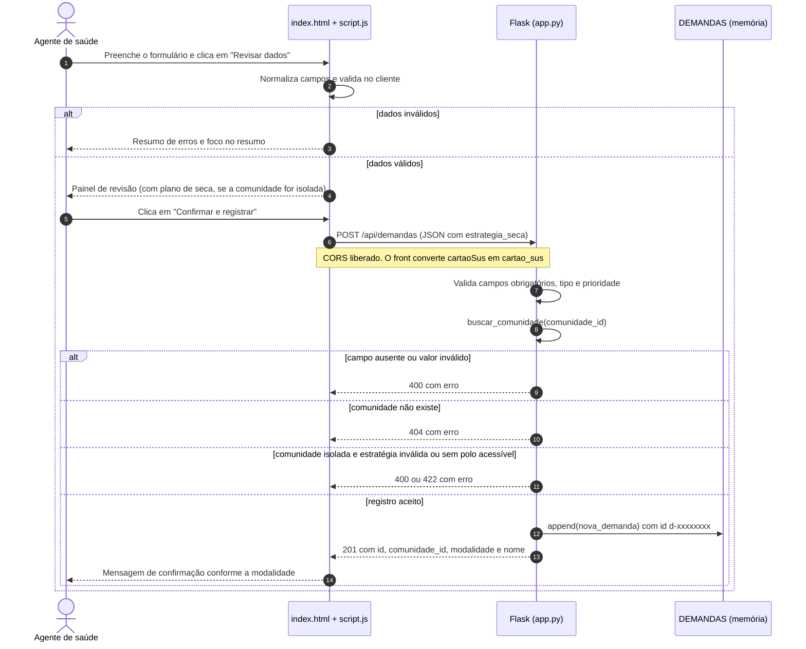
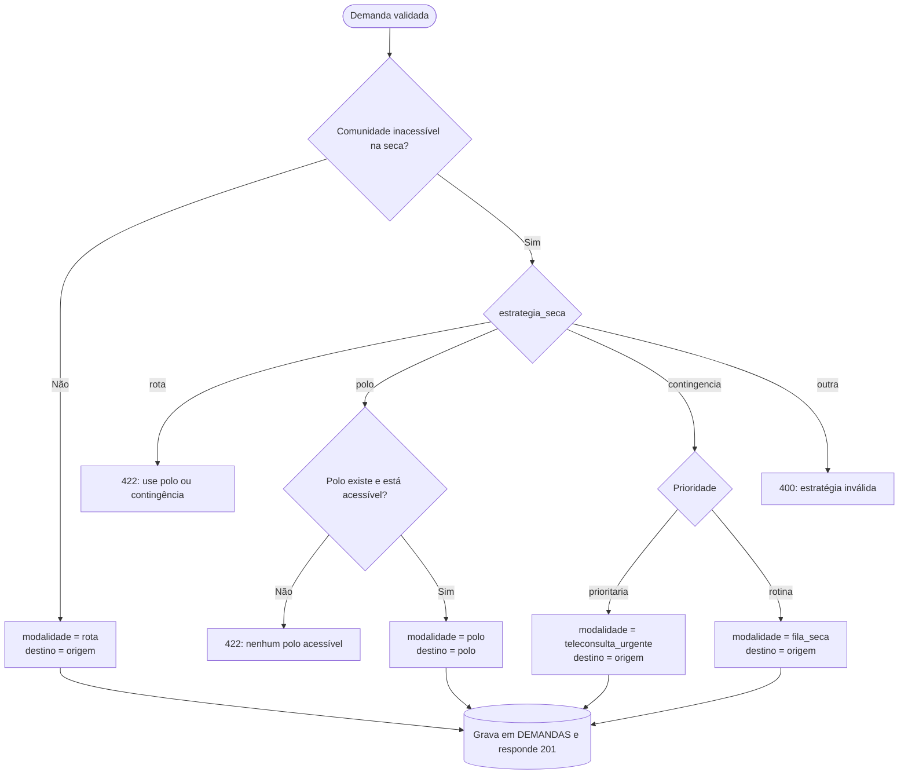
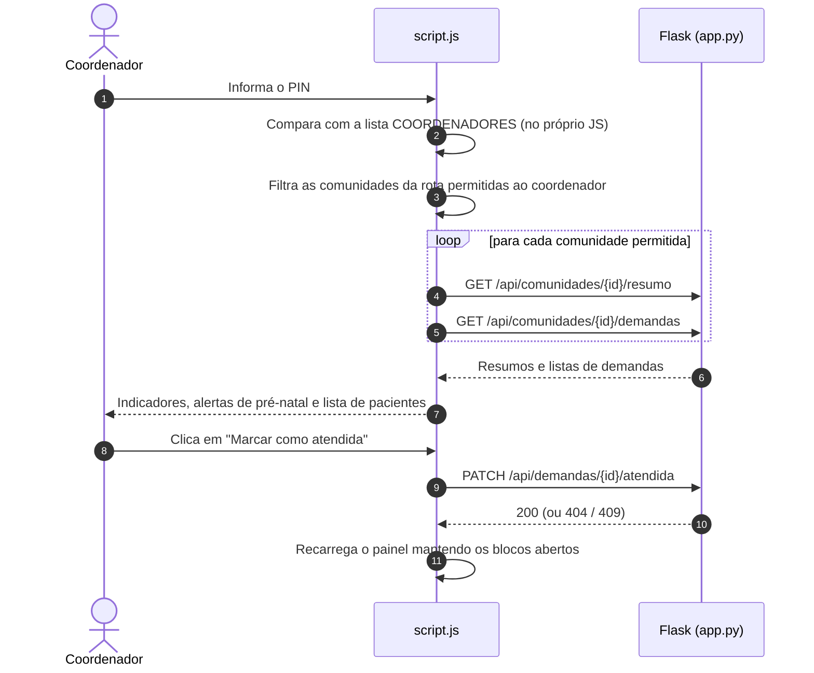

# Navega Saúde

Sistema web para **registrar e organizar demandas de saúde em comunidades rurais atendidas por rota**, com tratamento especial para o período da **seca**, quando algumas comunidades ficam inacessíveis.

O agente comunitário de saúde registra a demanda do paciente. A coordenação enxerga o que está pendente em cada comunidade da rota, com destaque para casos prioritários, excesso de pré-natal e urgências em comunidades isoladas.

> ⚠️ **Projeto em estágio de protótipo.** Os dados ficam em memória, não há autenticação real e há um endpoint usado pelo front-end que ainda não existe no back-end. Veja [Limitações conhecidas](#limitações-conhecidas) antes de qualquer uso com dados reais.

---

## Sumário

1. [Funcionalidades](#funcionalidades)
2. [Tecnologias](#tecnologias)
3. [Estrutura do projeto](#estrutura-do-projeto)
4. [Como executar](#como-executar)
5. [Regras de negócio](#regras-de-negócio)
6. [Diagramas: caminho de uma requisição](#diagramas-caminho-de-uma-requisição)
7. [Referência da API](#referência-da-api)
8. [Acessibilidade](#acessibilidade)
9. [Limitações conhecidas](#limitações-conhecidas)
10. [Transparência sobre o uso de IA](#transparência-sobre-o-uso-de-ia)
11. [Próximos passos](#próximos-passos)

---

## Funcionalidades

**Tela do agente de saúde**

- Formulário com comunidade, tipo de atendimento (clínico geral, pré-natal, ultrassom, odontologia, retorno), prioridade (rotina ou prioritária), nome, data de nascimento e Cartão SUS (opcional, 15 dígitos).
- Validação no navegador, com resumo de erros e mensagens por campo.
- **Etapa de revisão** antes do envio ("Confira os dados").
- Se a comunidade estiver **inacessível na seca**, o agente escolhe o plano de atendimento:
  - **Encaminhar ao polo:** o paciente é atendido na comunidade acessível de apoio.
  - **Contingência:** prioritárias acionam teleconsulta/remoção de urgência. Rotina entra na fila de espera da seca.

**Tela da coordenação** (protegida por PIN no front-end)

- Indicadores: demandas aguardando, prioritárias, comunidades com muito pré-natal e urgências de contingência.
- Cartão por comunidade com tabela por tipo de atendimento e alerta quando há **3 ou mais** casos de pré-natal.
- Lista de pacientes ordenada com as prioritárias primeiro, com botão **"Marcar como atendida"**.
- Filtro por regional: cada coordenador vê apenas as comunidades da sua região.

## Tecnologias

| Camada | Tecnologia |
|---|---|
| Back-end | Python 3, [Flask](https://flask.palletsprojects.com/), [Flask-CORS](https://flask-cors.readthedocs.io/) |
| Front-end | HTML5, CSS3 e JavaScript puro (sem framework e sem etapa de build) |
| Fontes | Atkinson Hyperlegible e Bricolage Grotesque (Google Fonts) |
| Armazenamento | Listas em memória no processo Flask (`COMUNIDADES`, `DEMANDAS`) |

## Estrutura do projeto

```text
.
├── app.py          # API Flask: rotas, validação e regras da seca
├── index.html      # Estrutura da página única (duas abas)
├── script.js       # Lógica do front-end: formulário, revisão, coordenação e chamadas à API
├── style.css       # Estilos, tema e responsividade
└── README.md
```

## Como executar

### Pré-requisitos

- Python 3.9 ou superior
- Um navegador moderno (o CSS usa `:has()`)

### 1. Back-end

```bash
# opcional: ambiente virtual
python -m venv .venv
source .venv/bin/activate        # Windows: .venv\Scripts\activate

pip install flask flask-cors
python app.py
```

A API sobe em `http://localhost:5000`.

### 2. Front-end

Em outro terminal, na mesma pasta:

```bash
python -m http.server 8000
```

Abra `http://localhost:8000`. A URL da API está fixa em `script.js` (`const API_URL = 'http://localhost:5000/api'`). Altere ali se a porta ou o host forem outros.

### PINs de demonstração (coordenação)

| PIN | Coordenador | Comunidades |
|---|---|---|
| `1010` | Dra. Helena (Coordenação Geral) | todas |
| `2020` | Enf. Carlos (Regional Norte) | c1, c2, c3 |
| `3030` | Enf. Mariana (Regional Sul) | c4, c5, c6 |

## Regras de negócio

### Comunidades de exemplo

| ID | Nome | Na rota | Inacessível na seca | Polo alternativo |
|---|---|---|---|---|
| c1 | Vila Esperança | sim | não | n/a |
| c2 | Ribeirão Seco | sim | **sim** | c1 |
| c3 | Sítio das Palmeiras | sim | não | n/a |
| c4 | Assentamento Novo Horizonte | sim | não | n/a |
| c5 | Beira do Rio | sim | **sim** | c4 |
| c6 | Serra Alta | **não** | não | n/a |

### Estratégia de seca (`estrategia_seca`)

Aplicada apenas quando a comunidade de origem tem `inacessivel_seca = true`.

| Estratégia | Resultado (`modalidade`) | Comunidade de destino |
|---|---|---|
| `rota` (padrão) | **Recusada com HTTP 422**, orientando a escolher polo ou contingência | n/a |
| `polo` | `polo` | Polo alternativo (se ele também estiver inacessível, retorna 422) |
| `contingencia` | `teleconsulta_urgente` se a prioridade for `prioritaria`, senão `fila_seca` | A própria comunidade de origem |

Comunidades acessíveis sempre geram `modalidade = rota`.

## Diagramas: caminho de uma requisição

### 1. Registro de uma demanda (`POST /api/demandas`)

O fluxo completo do agente de saúde, da tela até o armazenamento:



### 2. Decisão da estratégia de seca (dentro do `POST /api/demandas`)



### 3. Painel da coordenação



> ⚠️ O endpoint `/resumo` do passo 3 **não existe** no `app.py` atual. Veja [Limitações conhecidas](#limitações-conhecidas).

## Referência da API

Base: `http://localhost:5000/api`. Todas as respostas são JSON. Erros seguem o formato `{ "erro": "mensagem" }`.

| Método | Rota | Descrição | Respostas |
|---|---|---|---|
| `GET` | `/comunidades` | Lista comunidades, datas de visita e status de seca | 200 |
| `POST` | `/demandas` | Registra uma demanda | 201, 400, 404, 422 |
| `GET` | `/comunidades/<id>/demandas` | Lista demandas de uma comunidade (destino) | 200, 404 |
| `PATCH` | `/demandas/<id>/atendida` | Marca a demanda como atendida | 200, 404, 409 |
| `GET` | `/comunidades/<id>/resumo` | **Não implementado.** Usado pelo painel da coordenação | n/a |

### `POST /demandas`

Corpo:

```json
{
  "comunidade_id": "c2",
  "tipo": "prenatal",
  "prioridade": "prioritaria",
  "nome": "Maria da Silva",
  "nascimento": "1999-05-10",
  "cartao_sus": "123456789012345",
  "estrategia_seca": "polo"
}
```

- `tipo`: `clinico`, `prenatal`, `ultrassom`, `odonto` ou `retorno`
- `prioridade`: `rotina` ou `prioritaria`
- `estrategia_seca`: `rota` (padrão), `polo` ou `contingencia`
- `cartao_sus` é opcional. Os demais campos são obrigatórios.

Resposta `201` (somente o necessário para a confirmação na tela):

```json
{ "id": "d-3f9a1c2b", "comunidade_id": "c1", "modalidade": "polo", "nome": "Maria da Silva" }
```

### `GET /comunidades/<id>/demandas`

Retorna uma **projeção** dos campos: `id`, `comunidade_id`, `comunidade_origem_id`, `modalidade`, `tipo`, `prioridade`, `nome`, `nascimento` e `atendida`. O `cartao_sus` e o `criada_em` **não são enviados** à tela.

### `PATCH /demandas/<id>/atendida`

Retorna `{ "id", "nome", "atendida": true }`. Se já estava atendida, responde `409`.

### Contrato esperado de `GET /comunidades/<id>/resumo` (a implementar)

Deduzido do que o `script.js` consome:

```json
{
  "comunidade_id": "c1",
  "comunidade_nome": "Vila Esperança",
  "proxima_visita": "2026-11-28",
  "inacessivel_seca": false,
  "total_abertas": 4,
  "total_prioritarias": 2,
  "contingencia_urgente": 0,
  "redirecionadas_polo": 0,
  "por_tipo": {
    "prenatal": { "total": 3, "prioritarias": 1 },
    "clinico":  { "total": 1, "prioritarias": 1 }
  }
}
```

O front usa `por_tipo[tipo]` com valor padrão `{ total: 0, prioritarias: 0 }` para tipos ausentes.

## Acessibilidade

O projeto foi pensado para uso em campo e por pessoas com diferentes necessidades:

- Fonte **Atkinson Hyperlegible**, projetada para legibilidade.
- Link "Ir para o conteúdo", `role="alert"` / `role="status"` / `aria-live` para erros, confirmações e avisos.
- Gerenciamento de foco (resumo de erros, confirmação e painel de revisão).
- Mensagens de erro por campo, com texto (não só cor).
- Alvos de toque grandes, foco visível e layout responsivo.

## Limitações conhecidas

> Este sistema trata **dados pessoais de saúde** (nome, nascimento, Cartão SUS). Em produção, ele precisaria estar em conformidade com a **LGPD**.

**Funcionais**

- **Endpoint `/api/comunidades/<id>/resumo` ausente.** O painel da coordenação depende dele. Sem ele, o painel não carrega (o Flask responde 404 em HTML e o `resp.json()` falha).
- **Dados em memória.** Reiniciar o servidor apaga tudo. Os registros `ex-1` a `ex-4` são dados de exemplo recriados a cada inicialização.
- **Validação parcial no back-end.** O tamanho do Cartão SUS (15 dígitos), o formato e a plausibilidade da data de nascimento e o nome completo são validados só no front-end.

**Segurança**

- **Os PINs estão no JavaScript** e a mensagem de erro de PIN inválido revela quais são. Isso é apenas uma barreira de interface, não autenticação.
- **O filtro por regional ocorre só no navegador.** Qualquer pessoa pode chamar a API diretamente, ver demandas de qualquer comunidade e marcá-las como atendidas.
- **API sem autenticação e com CORS aberto** (`CORS(app)`).
- **`debug=True`** ligado em `app.py`: use apenas em desenvolvimento.
- O objeto do coordenador (incluindo o PIN) é guardado em `sessionStorage`.

**Pontos positivos de segurança já presentes**

- O DOM é montado com `createElement` e `textContent`, sem `innerHTML`, o que reduz risco de XSS.
- As listagens omitem campos sensíveis (`cartao_sus`, `criada_em`).

## Transparência sobre o uso de IA

> 📝 **Esta seção precisa ser preenchida pelo(s) autor(es).** O uso de IA não pode ser deduzido do código, por isso os campos abaixo estão em branco de propósito. Substitua cada `[PREENCHER]` e apague o que não se aplicar.

**Foi usada IA neste projeto?** `[PREENCHER: sim / não / parcialmente]`

**Ferramenta(s) e versão:** `[PREENCHER: ex.: Claude, ChatGPT, GitHub Copilot, Gemini]`

### Onde a IA foi usada

| Arquivo / parte | Tipo de ajuda | Descrição |
|---|---|---|
| `app.py` | `[PREENCHER: geração / revisão / refatoração / nenhuma]` | `[PREENCHER]` |
| `index.html` | `[PREENCHER]` | `[PREENCHER]` |
| `script.js` | `[PREENCHER]` | `[PREENCHER]` |
| `style.css` | `[PREENCHER]` | `[PREENCHER]` |
| Documentação (este README) | Redação a partir dos 4 arquivos de código | `[PREENCHER: confirme e informe como o texto foi conferido]` |

### Como o código foi revisado

`[PREENCHER: descreva o que foi de fato feito. Exemplos de itens possíveis:]`

- [ ] Leitura linha a linha do código gerado
- [ ] Execução manual dos fluxos (registro, seca com polo, contingência, painel)
- [ ] Testes automatizados (quais? onde?)
- [ ] Revisão por outra pessoa (quem? quando?)
- [ ] Verificação de acessibilidade (leitor de tela, teclado, contraste)
- [ ] Revisão de segurança e privacidade (LGPD)

**Problemas encontrados na revisão e como foram tratados:** `[PREENCHER]`

> A descrição da revisão deve refletir o que foi feito de fato. Ela não deve listar verificações que não ocorreram.

## Próximos passos

- Implementar `GET /api/comunidades/<id>/resumo` (contrato acima).
- Substituir PINs do front por **autenticação e autorização reais no servidor**, com filtro por regional aplicado na API.
- Trocar o armazenamento em memória por banco de dados (ex.: SQLite ou PostgreSQL).
- Validar Cartão SUS e data de nascimento também no back-end.
- Restringir o CORS, desativar `debug` e servir via HTTPS.
- Adicionar testes automatizados (API e fluxos do front).
- Registrar auditoria de quem marcou cada demanda como atendida e quando (o campo `atendida_em` já é gravado, mas não é exposto).
